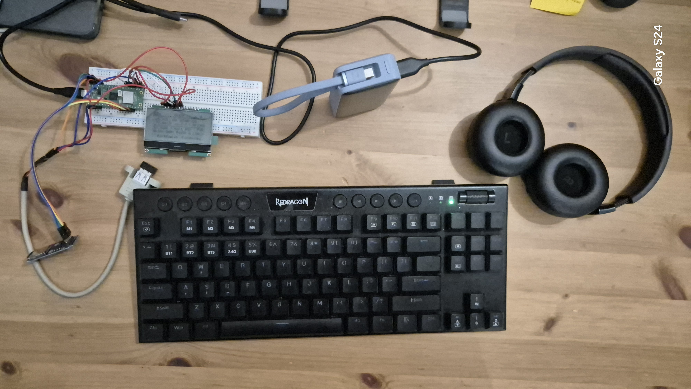
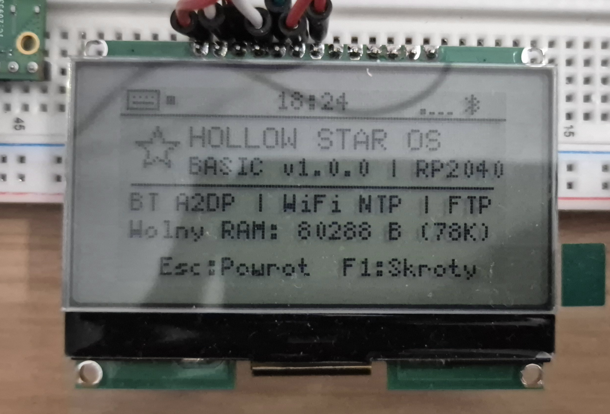
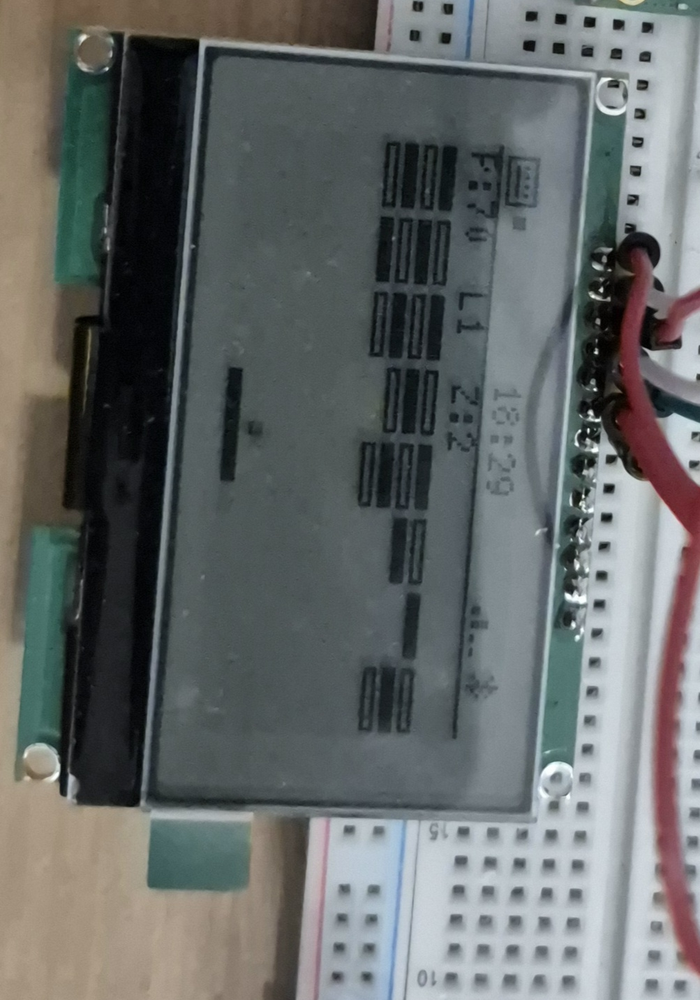
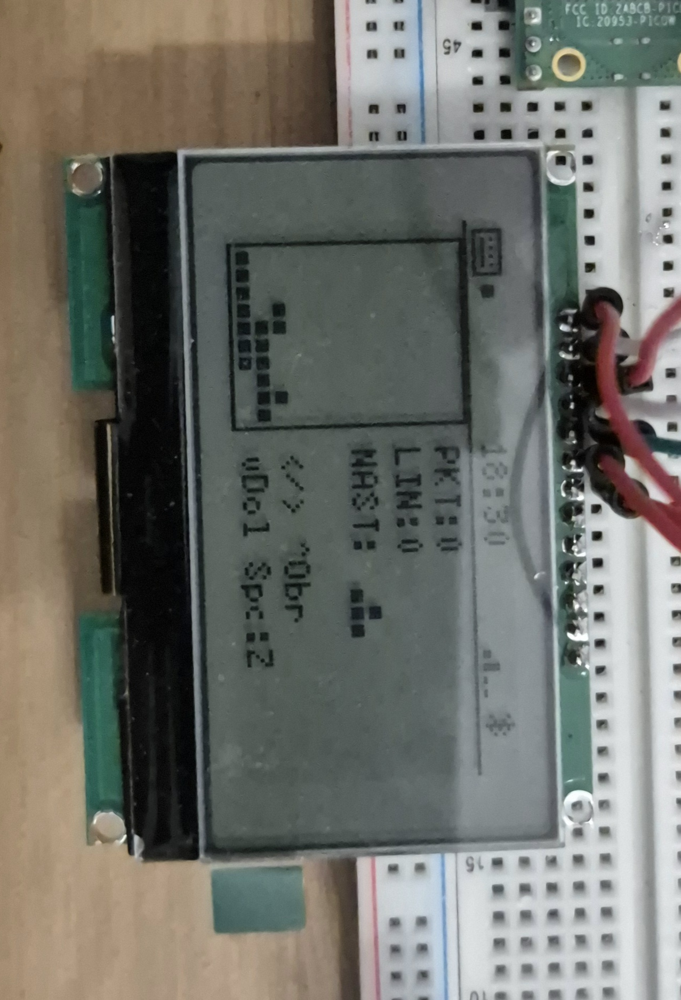
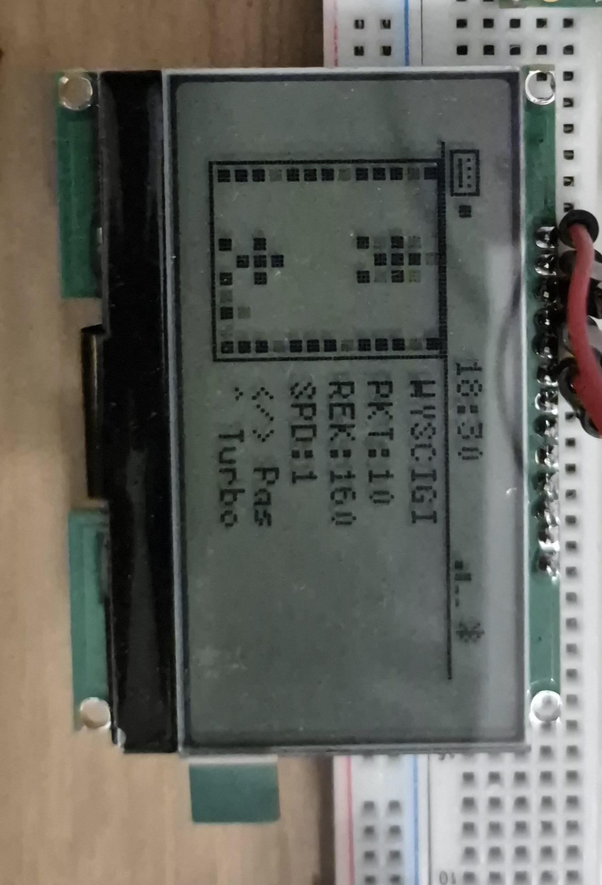

# Hollow Star OS Basic

> [!WARNING]
> **Vibe-Coded Project Notice:** This project is **vibe-coded** — built and iterated rapidly with AI coding assistance (`Google Antigravity`). While verified to compile cleanly for both Raspberry Pi Pico and Pico W, treat it as experimental hobby firmware: inspect the code and wiring before use, keep backups of important SD card data, and report or PR any edge-case bugs you encounter!

A compact, sharp-pixel embedded operating system for the **Raspberry Pi Pico & Raspberry Pi Pico W (RP2040)** running on **FreeRTOS SMP** (Arduino-Pico core v6.4.0), featuring a 128×64 monochrome LCD UI, USB 2.4 GHz keyboard input via PIO, dual **Bluetooth A2DP + 3.5 mm PWM Stereo Headphone Jack** audio, Wi-Fi + NTP clock sync, an authenticated PASV FTP server, a **First-Time Setup Wizard**, full **English / Polish (`EN`/`PL`)** bilingual UI, **TinyBASIC** interpreter, Markdown notes with blinking cursor & `F2` tutorial, expandable tree-view File Explorer, expression calculator, system monitor, and classic retro games.

---

## Demo & Hardware Setup

| Full Breadboard Setup (Pico W + Keyboard + ST7565 + BT Headphones) | About Screen (`ST7565` LCD) |
| :---: | :---: |
|  |  |

| Brick Breaker | Tetris | Brick Game Racing |
| :---: | :---: | :---: |
|  |  |  |

---

## Features

- **First-Time Setup Wizard (`v1.2.0`)**:
  - Automatically runs on first boot (or anytime from **Settings -> Language -> Run 1st Setup Wizard**):
    1. **Language Selection**: `English (Default)` or `Polski`
    2. **Wi-Fi Setup** *(Pico W only)*: Scan networks, enter password, connect, and auto-sync time via NTP (or skip)
    3. **Time Setup**: Manual `HH:MM` clock configuration (pre-filled if synced via NTP)
    4. **Welcome Screen**: Hollow Star branded `Welcome!` / `Witaj!` card
- **Bilingual OS (`English` / `Polski`)**: English by default across all menus, apps, settings, games, and `F1` help overlays, with instant switching to Polish in 1st Setup or **Settings -> Language**.
- **Raspberry Pi Pico & Pico W Builds**:
  - **Pico W (`hollow-star-os-picow-v1.3.0.uf2`)**: Full wireless suite (Bluetooth A2DP, Wi-Fi, NTP, FTP server) + 3.5 mm Headphone Jack.
  - **Standard Pico (`hollow-star-os-pico-v1.3.0.uf2`)**: Clean build without CYW43 — Bluetooth, Wi-Fi, NTP, and FTP UI menus are automatically hidden, while MP3 playback works over the 3.5 mm Headphone Jack.
- **TinyBASIC Interpreter (`v1.3.0`)**:
  - Built-in line-numbered BASIC interpreter & interactive REPL on Main Menu Page 2 (`LIST`, `RUN`, `NEW`, `CLR`, `SAVE`, `LOAD`, `FILES`, `HELP`, `PRINT`/`?`, `LET`, `INPUT`, `IF..THEN`, `GOTO`, `GOSUB/RETURN`, `FOR..TO..STEP/NEXT`, `CLS`, `DELAY`, `REM`, `END/STOP`, `A–Z` 32-bit integer variables, `RND()`, `ABS()`, and `Esc` break). Load and run `.bas` programs directly from File Explorer!
- **Audio Player & 3.5 mm Headphone Jack (`BT A2DP` / `PWM Jack`)**:
  - Plugging headphones/speakers into the 3.5 mm jack (`GP8` active-LOW detect) automatically disables Bluetooth and routes PCM audio to stereo PWM (`GP6` = L, `GP7` = R).
  - Manual output override (`O`: `AUTO` / `JACK` / `BT`), synchronized `MP3DecoderHelix` playback with `ID3v2` skip, 512-byte aligned A2DP writes (`24 KB` ring buffer, priority-2 audio task), `0–100%` software volume (`←`/`→` or `-`/`+`), animated 4-band equalizer, progress bar, and elapsed timer.
- **Sys Info Monitor**: Shows a `"Please wait..."` indicator while scanning disks, then displays live RP2040 CPU temperature, used/total heap RAM (`KB` & `%`), and free/total capacity on Flash (`LittleFS` Chip icon) and FAT32 SD card (SD icon).
- **Markdown Notes (`.md`)**: Choose **New Note** (defaults to `SD:/docs/`, auto-creating `/docs`) or **Load Existing** (browse Flash/SD directories), edit with a **blinking block cursor** and full `↑`/`↓`/`←`/`→` cursor navigation (`Ctrl+S` / `F3` save), toggle live preview (`Tab`), or press **`F2`** for a built-in scrollable **Markdown Tutorial**.
- **Tree-View File Explorer**: Expandable Flash & SD directory tree (`|---` connectors + sharp Folder, File, Music, Chip, and SD Card icons) supporting `.md` notes, `.mp3` playback, and `.bas` TinyBASIC execution.
- **Authenticated PASV FTP Server *(Pico W)***: Live Flash/SD drive switching (`←` / `→` / `Tab` / `D`), SD remount (`R`), and configurable FTP username/password (`U` / `P`, default `hollow` / `hollow`).
- **Expression Calculator & Classic Games**: Compute expressions (`+ - * / ( ) ^ sqrt cbrt` + fraction toggle `F2`), and play Brick Breaker, Tetris, and Brick Game Racing.
- **Sharp-Pixel UI & Universal `F1` Help**: Zero rounded corners, custom pixel icons (Folder, File, Music, Chip, SD Card), boot splash, status bar, hardware suspend (`setPowerSave(1)`), and context-sensitive `F1` shortcuts help on every screen.

---

## Prebuilt Firmware Downloads (`.uf2`)

Prebuilt flashable `.uf2` binaries (`Pico` and `Pico W`) are published directly in **[GitHub Releases](../../releases)**:
1. Download `hollow-star-os-picow-<version>.uf2` (for **Raspberry Pi Pico W**) or `hollow-star-os-pico-<version>.uf2` (for **Raspberry Pi Pico**).
2. Hold **BOOTSEL**, plug the Pico into USB, and drag-and-drop the `.uf2` file onto the `RPI-RP2` drive.

---

## Versioning Policy

This repository follows strict **Semantic Versioning** (`MAJOR.MINOR.PATCH`):
- **`MAJOR`**: Major architectural rewrites or breaking changes
- **`MINOR`**: New features (e.g. `v1.1.0` PWM Jack & Sys Info, `v1.2.0` 1st Setup & English/Polish i18n, `v1.3.0` TinyBASIC, Tree Explorer, Notes cursor & F2 tutorial)
- **`PATCH`**: Small fixes and refinements

---

## Hardware Pinout

| Subsystem | Pins | Notes |
| :--- | :--- | :--- |
| **ST7565R 128×64 LCD** | `SCL=GP18`, `SI=GP19`, `CS=GP17`, `RS=GP16`, `RSE=GP20` | 3.3V logic/power only (`A` via `47–100Ω` to `3V3`) |
| **Catalex MicroSD (`SPI1`)** | `VCC=VBUS (5V)`, `SCK=GP10`, `MOSI=GP11`, `MISO=GP12`, `CS=GP13` | FAT32, internal pull-up on `MISO` |
| **USB 2.4 GHz Keyboard (`PIO`)** | `VCC=VBUS (5V)`, `D+=GP2`, `D-=GP3` | Core 1 `Pico-PIO-USB` Host |
| **3.5 mm Headphone Jack (`PWM`)** | `L=GP6`, `R=GP7`, `Detect=GP8`, `GND=GND` | `62.5 kHz` PWM + RC filter, `GP8` `INPUT_PULLUP` active LOW |

Full wiring diagrams and the passive RC audio filter schematic are in [docs/wiring.md](docs/wiring.md).

---

## Build & Flash

### Required Arduino Configuration
- **Board**: Raspberry Pi Pico W (`rp2040:rp2040:rpipicow`) or Raspberry Pi Pico (`rp2040:rp2040:rpipico`)
- **Flash Size**: `2MB (Sketch: 1MB, FS: 1MB)`
- **Operating System**: `FreeRTOS SMP`
- **CPU Speed**: `240 MHz (Overclock)`
- **USB Stack**: `Adafruit TinyUSB`
- **IP/Bluetooth Stack**: `IPv4 + Bluetooth` (Pico W) / `IPv4 Only` (Pico)

### Using `pico.sh` (`arduino-cli`)
```bash
# Compile for Pico W (default) or standard Pico
./pico.sh build picow
./pico.sh build pico

# Build both release .uf2 files into build/
./pico.sh release

# Compile and flash directly
./pico.sh flash picow
./pico.sh flash pico

# Capture 5s of Serial logs (115200 baud)
./pico.sh logs
```

---

## Quick Keyboard Reference

| Context | Key | Action |
| :--- | :--- | :--- |
| **Any Screen** | `F1` | Open keyboard shortcuts help overlay |
| **Main Menu** | `Arrows` / `Tab` / `Enter` | Navigate / Page 1–2 / Launch |
| **Music Player** | `↑` / `↓` / `Enter` / `Space` / `S` | Track / Play / Pause / Stop |
| **Music Player** | `←` / `→` / `-` / `+` / `Tab` / `O` | Volume -/+ / Player↔Playlist / Output (`AUTO`/`JACK`/`BT`) |
| **Notes (`.md`)** | `↑` / `↓` / `←` / `→` / `Enter` | Choose New (default `SD:/docs/`) or Load from Flash/SD tree |
| **Notes Editor** | `↑` `↓` `←` `→` / `Ctrl+S` or `F3` / `Tab` / `F2` | Navigate cursor / Save `.md` / Preview / Markdown Tutorial |
| **File Explorer** | `↑` `↓` / `→` `Enter` / `←` / `Tab` | Select / Expand or Open (`.md`, `.mp3`, `.bas`) / Collapse / Flash↔SD |
| **TinyBASIC** | `Enter` / `Esc` | Run command or store numbered line / Break program or Exit |
| **FTP Server *(Pico W)*** | `U` / `P` / `←` `→` `D` / `Enter` / `R` | Set User / Set Password / Flash↔SD / Start-Stop / Remount SD |
| **Sys Info** | `R` / `Esc` | Refresh Flash & SD space / Menu |

---

## License

Licensed under the **GNU General Public License v3.0 (GPL-3.0)** — see the [LICENSE](LICENSE) file.
